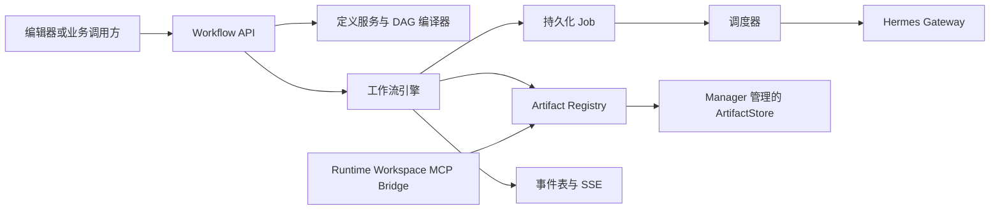
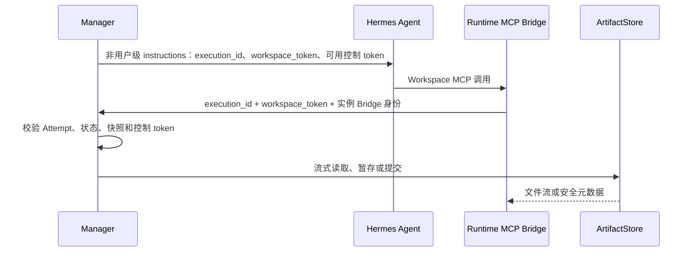

# Hermes Agent 工作流后端架构（DSL v2）

状态：当前实现基线

范围：`NineClaw-Manager` 与预置 Workspace MCP Bridge

本文说明工作流运行时的边界和数据语义。HTTP 接口见[工作流接口说明](hermes-agent-workflow-api.md)。工作流只接受 `schema_version: 2` 的定义；非该版本的草稿、发布快照和启动请求都会被拒绝，系统没有迁移或回退执行路径。切换时发现的历史 v1 队列会按失败收敛；已知远端 Hermes Run 只发送一次停止请求，停止结果不确定时保留 `stop_unconfirmed` 审计，绝不重新派发或物化输出。

## 1. 核心模型

Manager 负责定义校验、发布、调度、运行状态、Artifact、变量、控制决定、租户隔离和人工处置。Hermes 是独立的外部执行方。节点之间不共享容器目录、隐式对话历史、存储凭据或图结构。

工作流父图是纯 DAG。`loop` 是父图中的复合节点，其 Body 也是独立纯 DAG；首期禁止嵌套 Loop。节点通过共享 Artifact Workspace 与受管变量传递运行时信息。



定义中仅有五种节点：`start`、`end`、`hermes_agent`、`condition`、`loop`。节点 ID 格式为 `type_<16位小写UUID4短ID>`；`position.{x,y}` 为有限数，随草稿保存但不参与执行。`ui_metadata` 同样只服务编辑器。

## 2. 保存、发布与执行版本

创建、替换草稿、显式校验和发布都经过同一编译流程。它检查：

- 一个 `start`、至少一个 `end`、可达性、端口、无环和所有节点到达某个 End；
- 节点配置、资源上限、变量定义、表达式形状、Condition 与 Loop 约束；
- 顶层和 Loop Body 中 Hermes 实例的租户归属；
- 节点 ID、画布坐标和 DSL 结构。

保存失败返回稳定的编译问题列表，草稿不会部分写入。草稿更新和元数据更新使用 `draft_revision` 乐观并发控制。

发布会写入内部不可变快照。外部调用只能使用当前最新发布快照：启动 Run 与节点调试均不接受版本选择参数，也没有版本查询接口。已创建 Run 继续使用其创建时绑定的内部快照，新发布不会改变它。

## 3. Artifact Workspace

### 3.1 Artifact 种类与生命周期

每个 Run 都有受 Manager 管理的共享 Artifact Workspace。当前存储后端支持本地目录或 S3 兼容对象存储；Hermes 容器不直接连接这些后端。

| 种类 | 创建时机 | 用途 |
|---|---|---|
| `system_input` | 创建 Run 或调试 Run 时 | Manager 将请求输入写入 `workflow-input.json`。 |
| `system_output` | Hermes 成功后 | Manager 将远端结构化返回写入 `node-output.json`。 |
| `user` | 当前 Hermes Attempt 通过 Bridge 上传并提交后 | 节点产生的业务文件与中间产物。 |

系统 JSON 也是 Workspace 中可列举、可下载的 Artifact，但不计入业务 Artifact 字节配额。它们不会成为业务 Run 的最终交付物。

节点变为 `ready` 时，Manager 固定该节点的输入快照：已选上游路径的完整祖先闭包、Loop 继承的前轮产物、可见变量值及少量系统元数据。该快照中的 Artifact ID 是下载授权的唯一依据。之后上游新增文件、未选分支、失败 Attempt 或其他 Run 的文件都不会进入该节点的可见范围。

Hermes 成功后，`node-output.json` 与已提交的 `user` Artifact 归属于成功 Attempt。End 成功时，Manager 自动去重收集其已选上游闭包内、由成功 Attempt 产生的非系统 Artifact，写入业务 Run 的最终产物列表。失败、取消和节点调试 Run 的最终产物为空。

### 3.2 文件访问边界

Agent 的任务消息不注入图、上游节点输出或存储地址。Agent 通过固定 MCP 工具列举 Artifact 元数据，再按 ID 下载所需文件，并把自身文件上传为当前 Attempt 的输出。Manager 对每次请求校验活跃 Attempt、Run 状态和冻结快照。

前端浏览使用 `GET /v1/workflows/runs/{run_id}/workspace`。它按实际 Agent Node Run 和 Loop Scope 展示 Artifact 元数据及最终产物，不返回对象 URI、Bucket、NFS 路径、预签名地址、Attempt ID 或 Bridge 凭据。

## 4. 工作流变量

变量定义属于工作流 DSL，并在发布后随内部快照固定。定义包含名称、类型和可选描述；支持 `string`、`integer`、`number`、`boolean`、`object`、`array`、`null`。Agent 无法新增或修改变量定义。

变量值按 Attempt 生命周期处理：

1. 节点启动时读取冻结快照中的上游变量状态。
2. Agent 通过 `variables_set` 或 `variables_set_many` 写入当前 Attempt 的暂存值；该 Attempt 内立即可读。
3. Hermes 成功后，Manager 提交暂存值与控制决定，并把结果写入该节点状态。
4. 失败、取消、结果不确定、停止结果不确定或人工替换 Attempt 时，暂存值、已提交值、控制决定和该 Attempt 的 Artifact 均失效。

下游只会看见成功节点提交的值。线性路径允许后继覆盖前值；并行合流时，同名变量的不同值会使目标节点以 `VARIABLE_CONFLICT` 失败，不能按到达顺序覆盖。

公式只读取 `vars.*` 与 `system.*`。`system` 当前提供 Artifact 元数据、Artifact 数量与 Loop 迭代索引；公式不能读取 Artifact 文件内容。表达式使用受限 JSON AST，保存期验证操作符和形状，路径存在性及动态值类型在运行期验证。

## 5. 控制节点

### 5.1 Condition

Condition 的 `config.mode` 为 `formula` 或 `agent`，均需要至少两个唯一 `ports`。边从 Condition 出发时，`source_port` 必须是其中之一。

- `formula`：配置 `expression`、`true_port`、`false_port`。Manager 在节点输入快照上求值，真值选择 `true_port`，否则选择 `false_port`。
- `agent`：Condition 必须只有一个直接上游，且该上游为 `hermes_agent`。Manager 在该 Agent Attempt 的非用户级 instructions 中注入一次性 token 与允许端口。Agent 调用 `condition_select_port` 提交端口；Agent 成功后该决定才提交。缺失、重复或非法决定会使 Condition 失败。

token 只表达一次控制动作，不暴露目标节点 ID、图结构或存储信息。

### 5.2 Loop

Loop 的 `config.body` 是完整 DSL v2 Body，Body 继承外层变量定义且不能重新声明变量，并且必须只有一个 End。每轮都至少运行一次；下一轮继承前轮的成功 Artifact 与该 End 的变量状态。Loop 完成后，其下游可通过已选 Loop 路径看见成功迭代的 Artifact。

`config.termination` 有两种模式：

- `formula`：`termination.expression` 在一轮 Body 成功结束后由 Manager 以 `vars.*` 与 `system.*` 求值；结果为真表示终止本 Loop。
- `agent`：`termination.source_node_id` 指向 Body 内一个 Hermes Agent。该 Agent 获得一次性 token，调用 `loop_continue` 提交 `should_continue`；`true` 继续，`false` 终止。

`limits.max_iterations` 必须是正整数。达到上限仍请求继续时，Loop 以 `LOOP_LIMIT_EXCEEDED` 失败。缺失、重复或非法的 Agent 决定，以及公式求值失败，都会使 Loop 失败。

## 6. 调度、长任务与不确定性

运行由持久化 Job 调度，使用租约、fencing token、去重键和条件状态推进。Hermes 创建、停止或审批的响应缺失、超时或断连时，Manager 无法证明远端未执行，会将节点标记为 `uncertain` 或 `stop_unconfirmed`，不自动重发副作用调用。

人工可将不确定节点按失败收敛，或在确认可能重复副作用后重试。Monitor 仅轮询已知 Hermes Run，不会重新创建。

工作流不设置总运行时长。长任务由持久化 Monitor Job 持续查询；资源控制来自节点执行次数、Hermes Run 次数和业务 Artifact 字节配额，单次网关请求仍受部署级 HTTP 超时约束。

## 7. Runtime Workspace MCP Bridge

每个 Hermes Attempt 生成唯一 `execution_id` 与 Attempt 级不透明 `workspace_token`。Manager 把二者写入非用户级 instructions，并以 `execution_id` 作为 Hermes session 标识。Runtime 镜像预置本地 stdio MCP Bridge，Bridge 通过 Manager 完成所有 Workspace 操作。



当前固定 MCP 工具如下：

| 工具 | 作用 |
|---|---|
| `workspace_list` | 列出冻结快照中的 Artifact 元数据。 |
| `workspace_download` | 下载一个已授权 Artifact 到当前本地工作目录。 |
| `workspace_upload` | 暂存并原子提交当前 Attempt 的业务 Artifact。 |
| `variables_list`、`variables_get`、`variables_set`、`variables_set_many` | 查询或暂存受类型约束的工作流变量。 |
| `condition_select_port` | 用一次性 token 提交 Agent Condition 的端口。 |
| `loop_continue` | 用一次性 token 提交 Agent Loop 的继续或终止决定。 |

每个 MCP 工具都要求同时传入 `execution_id` 与 `workspace_token`。本地路径被限制在 `/tmp/nineclaw-workspace/<execution_id>/` 下。Run 终态、取消、Attempt 被替换或处于不确定状态时，Bridge 操作被拒绝。

### 7.1 Attempt 级鉴权

Bridge 请求同时携带实例派生 Bearer Token、`X-Nineclaw-Workspace-Instance` 与 `X-Nineclaw-Workspace-Token`。`workspace_token` 由 Manager 的 Bridge 密钥、实例 ID 和 `execution_id` 以 HMAC 派生，绑定到一个 Attempt。Runtime MCP 会先校验 token 形状，再将其放入请求 Header。

Manager 在查询 Attempt 前校验该 token；不匹配或缺失时统一返回 `404`，避免同一 Hermes 实例枚举或借用其他活跃 `execution_id`。随后仍校验实例、活跃 Attempt、Run 状态、冻结 Artifact 快照和控制 token。`execution_id` 是定位符，`workspace_token` 是 Manager 授权令牌；二者均不是对象存储凭据。

`workspace_token` 只出现在 Attempt 的非用户级 instructions、Runtime MCP 参数和 Manager 内部 Header。Manager 注入的 Workspace 运行环境（包括 `NINECLAW_MANAGER_URL` 与 `NINECLAW_WORKSPACE_*`）不持久化到实例配置，也不进入公开 API、Agent 目录、Workspace 浏览或事件投影。

## 8. 事件、目录与独立对话

`workflow_events` 是 Run 生命周期的持久化事实源。状态推进、边解析、后继 Job 创建和事件追加在同一事务内完成；每个 Run 的 `sequence` 单调递增。事件列表与 SSE 支持通过 `after_sequence` 或 `Last-Event-ID` 重放，客户端按 `(run_id, sequence)` 去重。公开事件经过字段白名单投影，不转发 Hermes token delta 或内部执行定位信息。

`GET /v1/workflows/agent-catalog` 读取 Manager 保存的 Agent 配置安全快照，展示名称、状态、模型、知识库、MCP 与 Skill 的白名单字段。它不实时探测 Hermes，也不返回原始配置、密钥或私有地址。

顶层 `hermes_agent` 支持独立对话。创建时固定当时最新发布快照中的节点配置；对话不创建 Workflow Attempt，不携带 Workspace 身份，因此不能读取或写入工作流 Artifact 与变量。

## 9. 持久化与安全边界

核心对象包括 Workflow、内部发布快照、Run、Scope、Node Run、Attempt、Edge Run、Job、Event、Artifact、变量写入和控制决定。Loop 每轮拥有独立 Scope；变量和 Artifact 的继承均由 Scope 保存。

Manager 是 ArtifactStore 的唯一访问者。公开 API、Agent 目录、Workspace 浏览、Run 事件和对话投影不得泄露存储 URI、Bucket、NFS 路径、预签名 URL、Bridge Token、`execution_id`、Hermes Run ID 或内部发布标识。所有 Workflow 相关查询按 `tenant_id` 过滤。

Workspace Bridge 在鉴权 Attempt 后还会校验其关联发布快照。历史 v1 Attempt 一律返回 `409 WORKFLOW_DSL_V1_UNSUPPORTED`，不能读写 Artifact、变量或控制决定。

## 10. 当前限制

- 不支持嵌套 Loop、动态 fan-out、`foreach`、跨 Run Artifact、全局可变变量或隐式变量合并。
- 不提供暂停/恢复、自动恢复不确定 Hermes 创建或对话访问工作流 Workspace。
- Agent 不具备 Artifact 内容解析能力；需要解析时由 Agent 下载后自行处理，或由未来需求单独定义受管解析能力。
- 远端 Hermes 配置成功与 Manager 资源快照写入不构成分布式事务；目录展示最近一次成功写入的快照。

## 11. 验证建议

工作流实现变更可执行：

```bash
cd /Users/zacks/workspace/work/projects/nineclaw/NineClaw-Manager
uv run pytest tests/test_workflow_compiler.py tests/test_workflow_runtime.py tests/test_workflow_workspace.py tests/test_workflow_artifacts.py -q
uv run python -m compileall -q app
uv run alembic upgrade head --sql
```

需要数据库的测试应使用已迁移的临时 PostgreSQL；未配置时应明确记录跳过。
